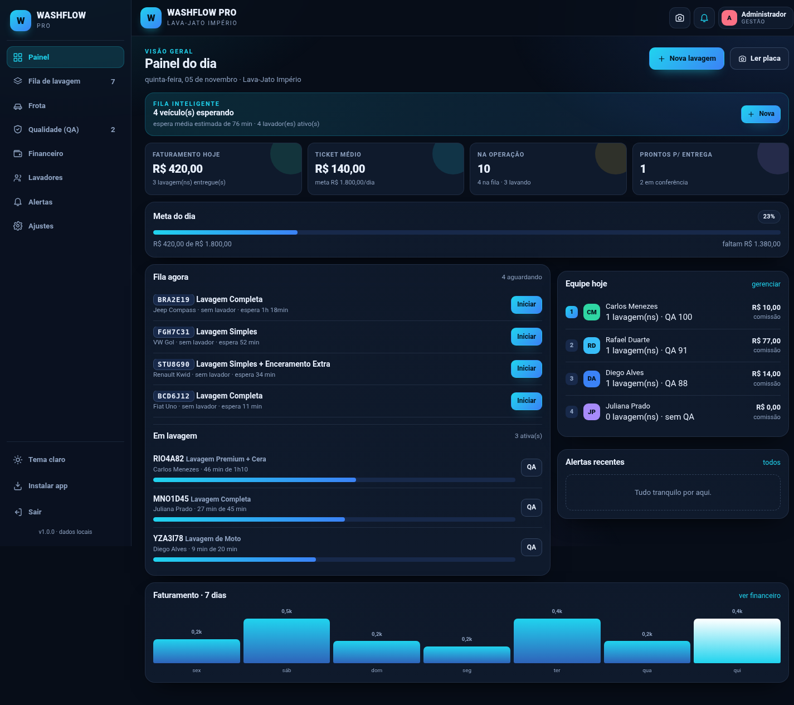
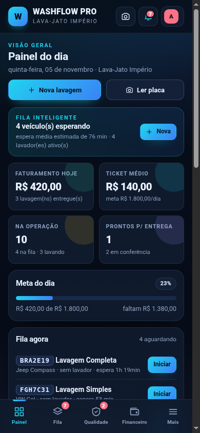
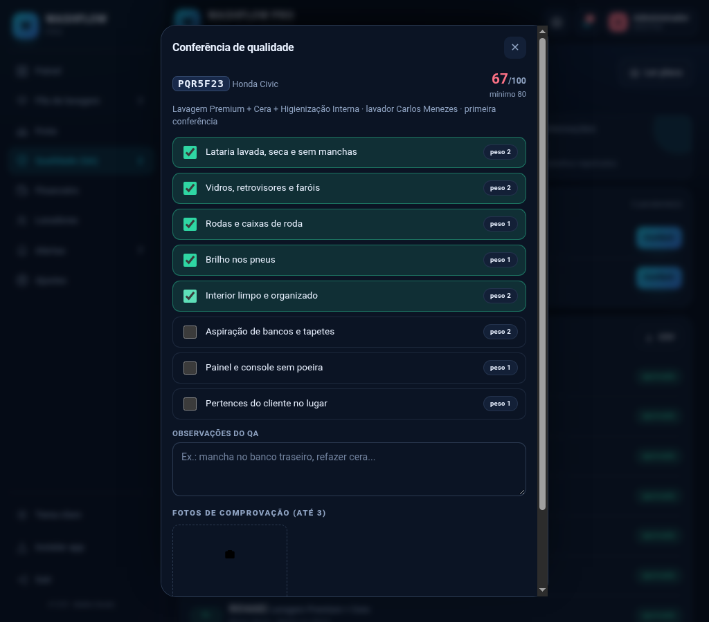

# WASHFLOW PRO

Aplicativo web instalável (PWA) para gestão de lavajatos: frota, fila de lavagem, conferência de qualidade (QA), leitura de placa pela câmera, financeiro com comissões, app exclusivo do lavador, alertas inteligentes e backup completo.

Funciona **sem servidor**: os dados ficam salvos no próprio aparelho (localStorage), o que permite uso offline e instalação na tela inicial do celular.



## Acessos de demonstração

| Perfil | Acesso |
| --- | --- |
| Administrador | PIN **1234** |
| Lavador Carlos | PIN **1111** |
| Lavador Rafael | PIN **2222** |
| Lavador Juliana | PIN **3333** |
| Lavador Diego | PIN **4444** |

Os PINs podem ser trocados em **Lavadores → Editar**.

## Como rodar

Não precisa de build nem de dependências. Basta servir a pasta como site estático:

```bash
python3 -m http.server 3000
# abra http://localhost:3000
```

Também funciona em qualquer hospedagem estática com HTTPS (Cloudflare Pages, Netlify, Vercel, GitHub Pages). Abrir o `index.html` direto por `file://` funciona só parcialmente: service worker, câmera e instalação exigem `http://localhost` ou HTTPS.

Versão publicada: https://site-710f08c10a504fdf96c67f8eef3d3129.freebuff.page

## Recursos

- **Painel do dia** — faturamento, ticket médio, meta, fila, equipe e alertas em tempo real.
- **Fila de lavagem** — quadro Aguardando → Em lavagem → QA → Pronto, com tempo de espera, prioridade, atribuição automática e entrega com forma de pagamento.
- **Frota** — cadastro por placa (Mercosul e padrão antigo), mensalistas com vencimento, histórico e atalho para abrir nova ordem de serviço.
- **QA** — checklist com pesos, nota 0–100, fotos de comprovação, aprovação a partir de 80 e reprovação com retorno para retrabalho.
- **Leitor de placas** — câmera traseira, captura do quadro, OCR com Tesseract.js e busca imediata do veículo; se a placa não existir, abre o cadastro já preenchido.
- **Financeiro** — receita, despesas, comissões, lucro, ticket médio, receita por serviço e por forma de pagamento, gráfico de 7 dias, filtros por período e exportação CSV.
- **Lavadores** — cadastro, PIN, turno, comissão, produtividade, nota média de QA e ganhos do dia.
- **App do lavador** — login próprio, assumir e iniciar, envio para QA, ganhos e perfil, sem acesso ao financeiro.
- **Alertas inteligentes** — fila acima de 45 min, atraso na lavagem, QA pendente, veículo pronto sem retirada, mensalidade vencendo/vencida e meta batida.
- **Backup** — exporta e importa tudo em um JSON (substituindo ou mesclando), além de CSV de ordens, despesas e equipe.
- **Ajustes** — dados do lavajato, meta diária, horários, serviços e preços, tema claro/escuro e instalação do app.




## Estrutura

```
index.html            app shell
manifest.webmanifest  instalação (PWA)
sw.js                 cache offline
assets/app.css        design system responsivo
assets/core.js        estado, regras de negócio, financeiro, QA, backup
assets/app.js         telas, navegação, câmera/OCR, eventos
assets/icons/         ícones 192/512 e maskable
```

As versões de CSS/JS são referenciadas com `?v=` no `index.html`; ao publicar mudanças, atualize essa versão e o nome do cache em `sw.js` para o app atualizar nos aparelhos.

## Limitações conhecidas

1. **Sem backend:** os dados são locais por aparelho. Multiusuário simultâneo, sincronização entre dispositivos e login por e-mail exigem servidor (banco de dados + autenticação).
2. **Push real** (com o app fechado) precisa de um servidor de notificações; aqui os alertas são gerados no app e aparecem como notificação do navegador enquanto ele está aberto ou instalado.
3. **OCR de placas** carrega o Tesseract de CDN na primeira leitura; sem internet o app orienta digitar a placa. A precisão depende de luz, ângulo e distância.
4. **Câmera** exige HTTPS ou localhost.
